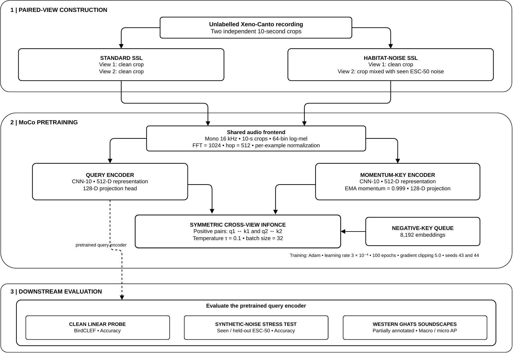
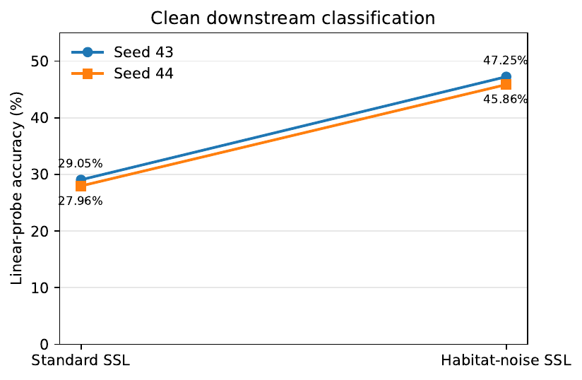
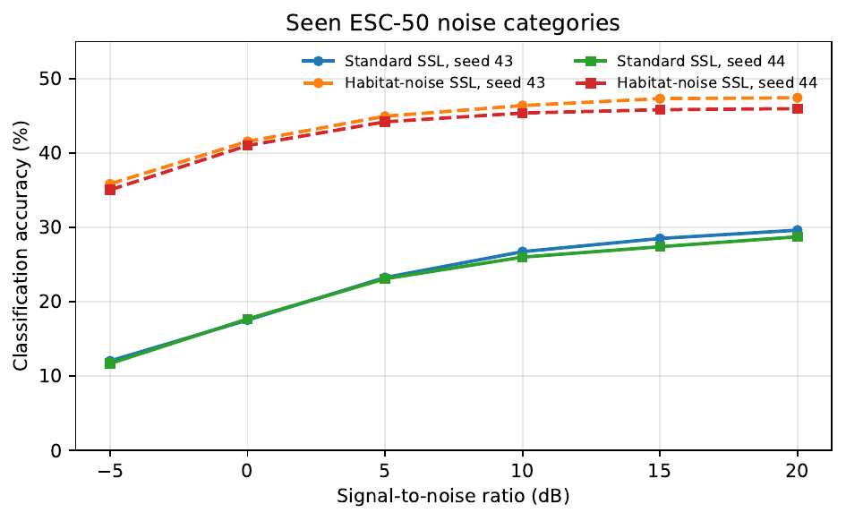
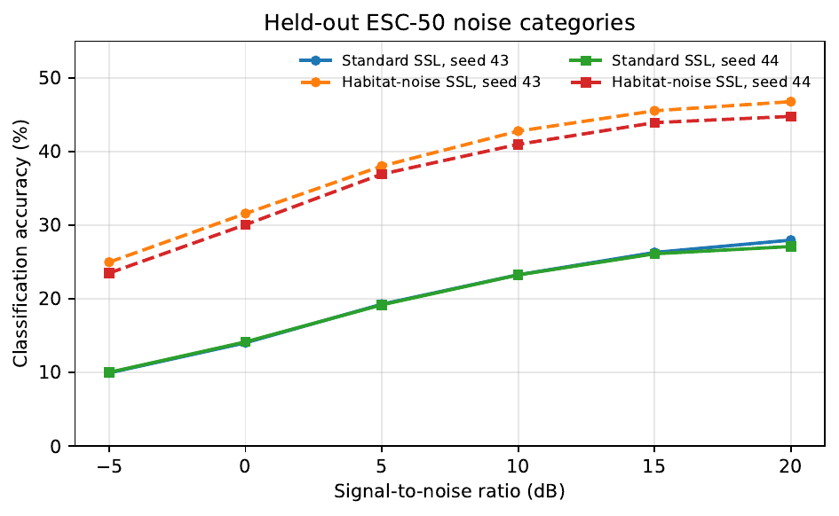
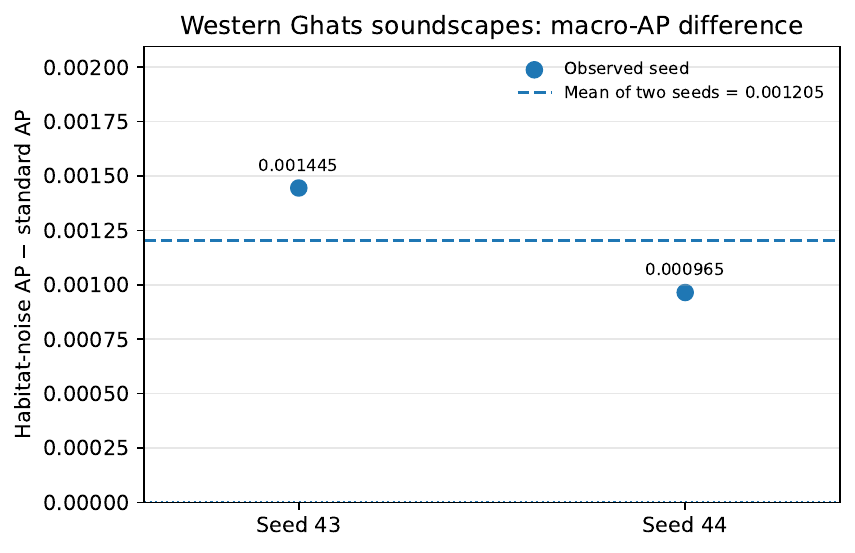
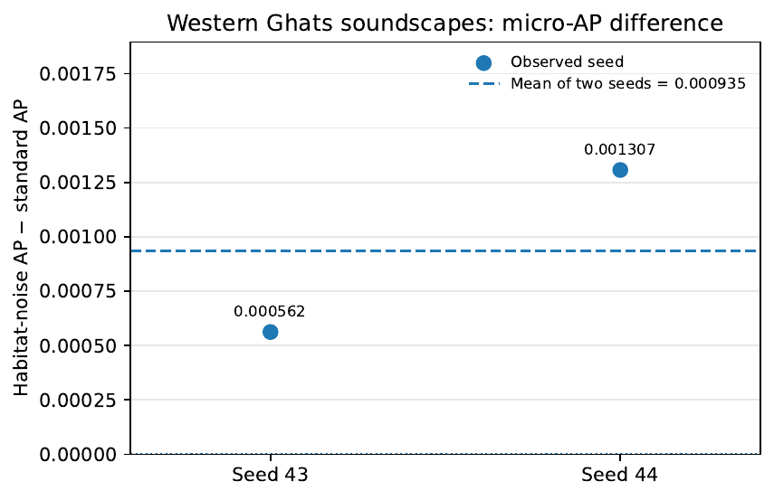
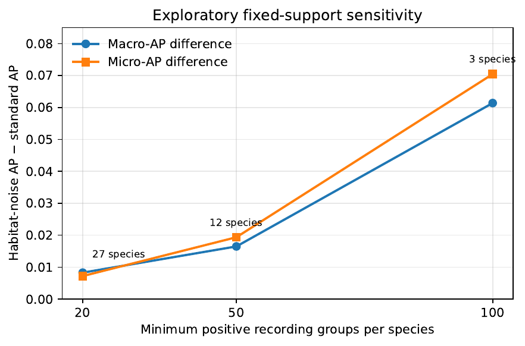

# An Exploratory Comparison of Standard and Habitat-Noise MoCo Pretraining for Bird-Sound Classification

**Publication status - Not yet published or peer reviewed.**

The research examines whether incorporating environmental noise into audio views during self-supervised pretraining is associated with improved bird-sound classification. Comparison is made between Momentum Contrast (MoCo) with two clean speech crops versus habitat noise MoCo where there is one clean crop and another mixed with environment audio from ESC-50.

## Pipeline



Unlabeled Xeno-Canto audios are represented using 10 seconds of mono 16kHz audio and 64-bin log-mel features. A CNN-10 encoder learns representations via symmetric cross-view InfoNCE loss, momentum key encoder, and negative-key queue. The trained query encoder model is evaluated using a BirdCLEF linear probe, synthetic ESC-50 noise perturbations, and Western Ghats partly annotated soundscapes.

As per the ESC-50 mixer, noise labeled output samples showed increased accuracy compared to the normal labeled output samples at six different signal to noise ratio values (+20, +15, +10, +5, 0, and -5 dB). The findings outlined above can be applied only to this specific mixer.

## Results

The below values are descriptive findings from the labelled outputs that exist. They cannot be considered a properly vetted causative comparison due to the incomplete provenance of the labelled seed-43 run.

### Clean BirdCLEF linear probe

| Seed | Standard-labelled SSL | Habitat-noise-labelled SSL |    Difference |
| ---- | --------------------: | -------------------------: | ------------: |
| 43   |                29.05% |                     47.25% | +18.20 points |
| 44   |                27.96% |                     45.86% | +17.91 points |
| Mean |                28.51% |                     46.56% | +18.05 points |



### Synthetic ESC-50 noise tests

The results for the ESC-50 mixing process showed that the noisy labeled output samples showed more accuracy than the normal labeled output samples for all the six different values of SNR (+20dB, +15dB, +10dB, +5dB, 0dB and -5dB) used in both seen as well as unseen noisy types. The findings made in this research are limited to this mixer only.





### Western Ghats soundscapes

| Metric                       | Standard-labelled SSL | Habitat-noise-labelled SSL | Difference |
| ---------------------------- | --------------------: | -------------------------: | ---------: |
| Macro average precision (AP) |              0.012682 |                   0.013887 |  +0.001205 |
| Micro average precision (AP) |              0.007825 |                   0.008759 |  +0.000935 |

The minor differences are just an exploration. The soundscape labels are incomplete, the background sound samples are weak negative examples as opposed to confirmed absence and species level reactions were diverse.

<details>
<summary>Additional result figures</summary>







</details>

## Datasets

- **Xeno-Canto:** Unlabeled bird sounds used for self-supervised pre-training.
- **BirdCLEF 2024:** Labeled task for downstream bird classification. The data split provided is 14,592 train, 5,003 validation, and 4,847 test examples, comprising 179 active classes.
- **ESC-50:** Environmental sounds used for creating habitat-noise and synthetic-noise tests.
- Western Ghats soundscapes: Partially labeled recordings used for macro/micro-AP experiments.

Datasets should be downloaded from their respective sources and stored in the specified directory `data/raw`.
Audio data, caches, and models trained are not included in this README bundle.## Codebase map

## Codebase

- `configs/` — training and evaluation configurations.
- `experiments/` — MoCo pretraining, linear probes, synthetic-noise evaluation, and soundscape evaluation.
- `scripts/` — dataset preparation, audio preflight, integrity audits, analysis, and pipeline submission.
- `results/` — run logs, aggregate metrics, tables, and plots generated by experiments.
- `tests/` — unit tests.
- `data/processed/` and `checkpoints/` — local manifests, cached audio, and model artifacts generated during runs.

## Setup

For the pipeline, Python 3.10 or 3.11 should be used. Firstly, it is important to acquire the datasets; the repo is unable to do that as the datasets are secured via the users’ accounts.

```bash
python3 -m venv .venv
source .venv/bin/activate
python -m pip install --upgrade pip
python -m pip install -r requirements.txt
python -m unittest discover -s tests -v
```

With the SLURM cluster configured, the workflow is started with the command `scripts/submit_pipeline.sh`. It is recommended that you check your resource and module settings and ensure that your data and split manifest files are ready for long processing.

## Limitations

Just two pretraining seeds are included in the comparison that has been documented. The seed-43 log and checkpoint with the standard label have a path and hash for a habitat noise setup, and thus the effective view construction of the seed cannot be validated using the provided evidence. There is no verifiable white noise pretraining outcome and/or ablation outcome.

The field evaluation is limited by incomplete annotations and sampled background segments used as weak negatives rather than verified absences. Portions of the Western Ghats soundscape collection were used as the hidden BirdCLEF 2024 test set, so this evaluation is not independent of the historical BirdCLEF 2024 benchmark.
